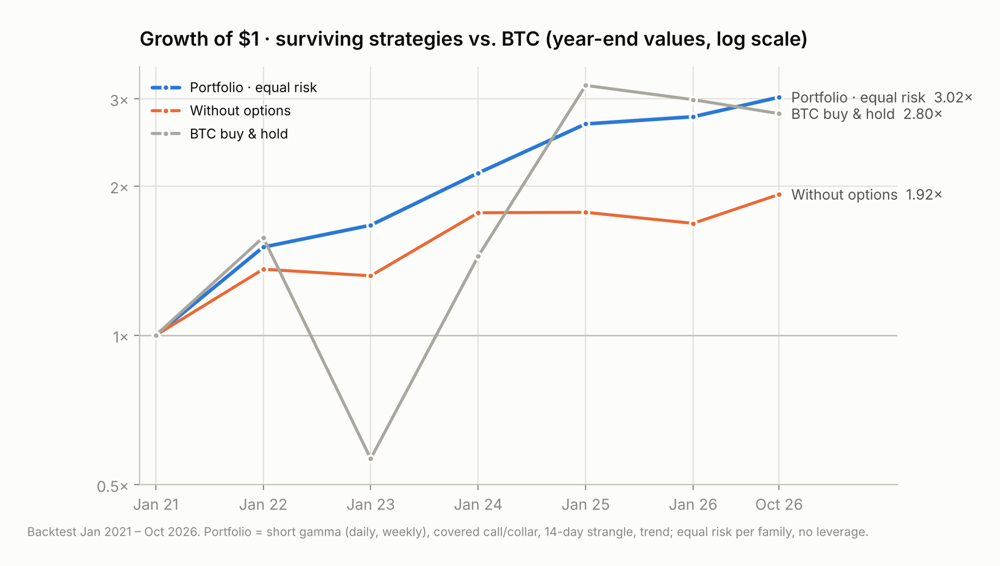
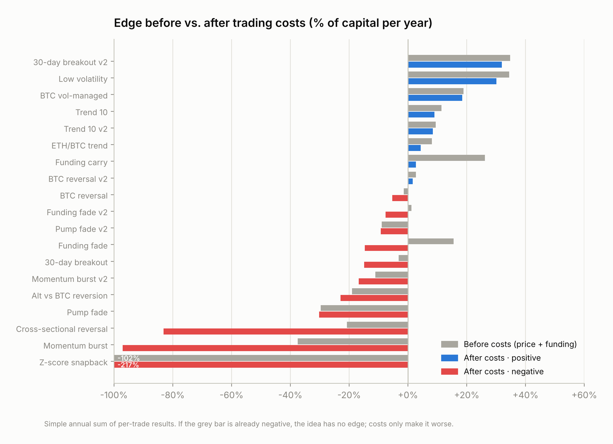
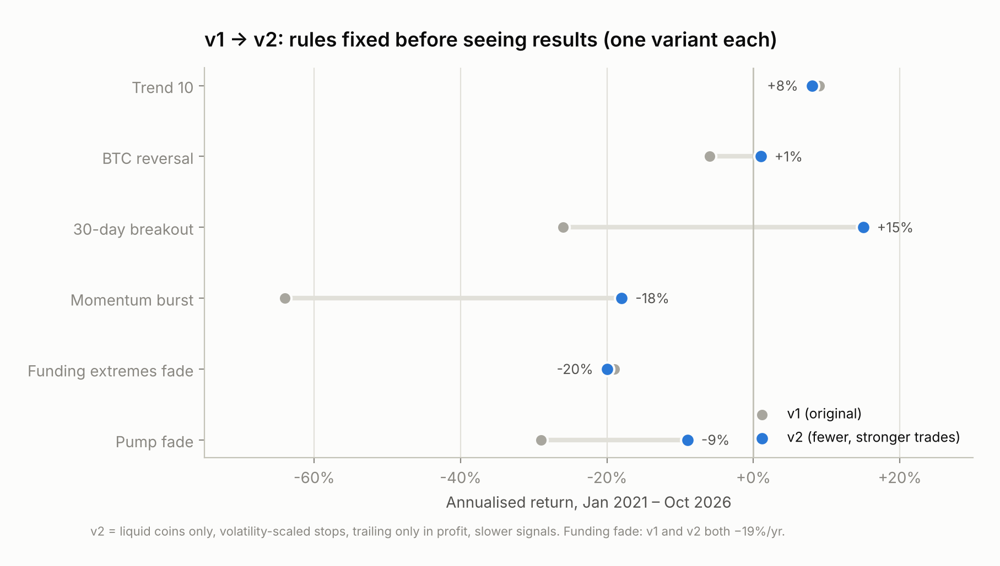
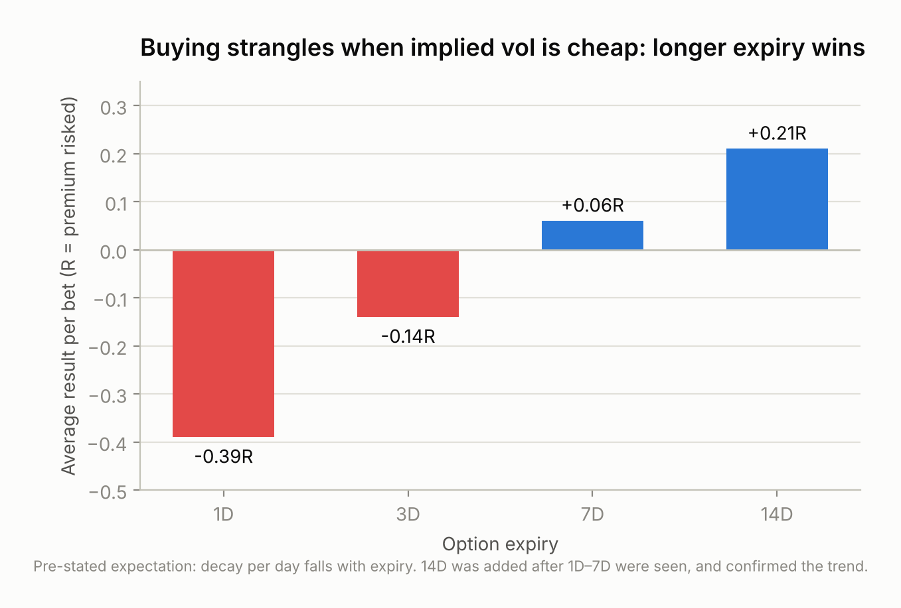
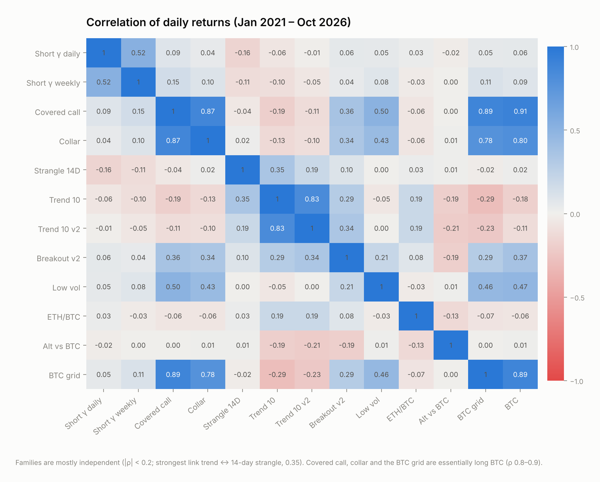
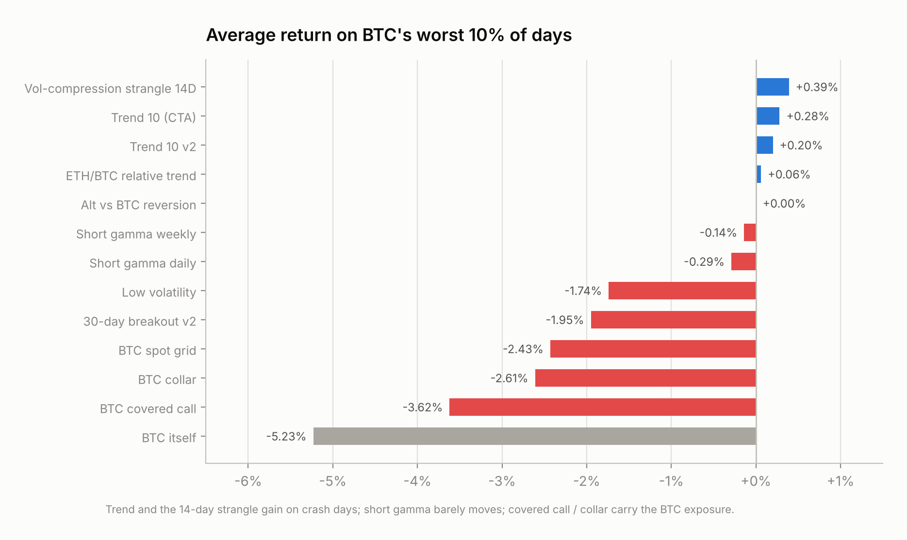
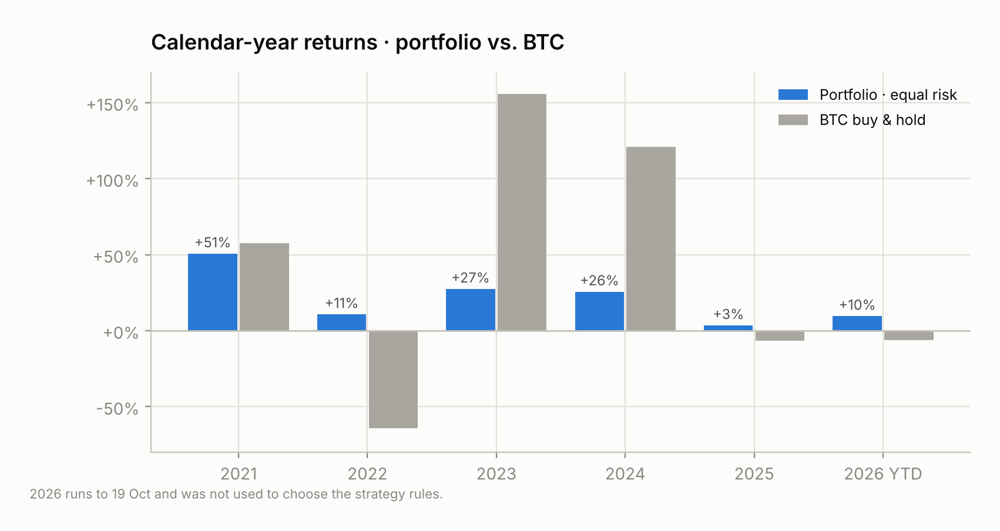
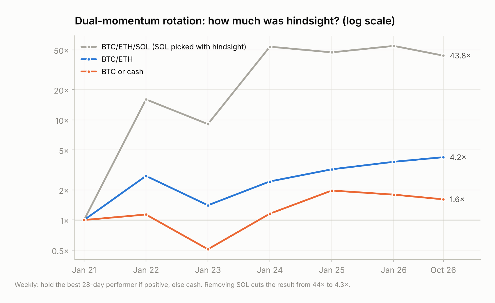
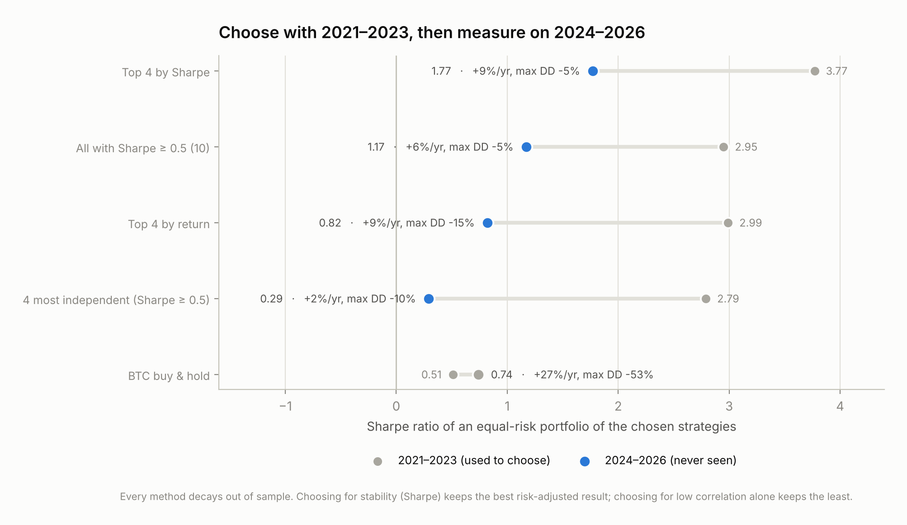
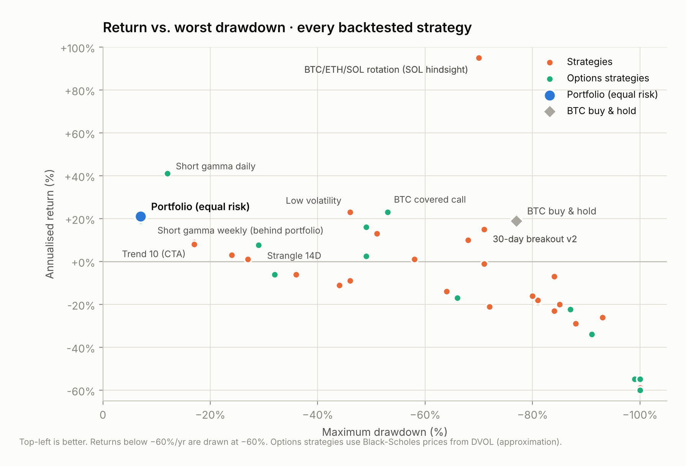

# Crypto Strategy Risk Research

**What systematic crypto strategies really look like once trading costs, wicks, funding and crashes are measured properly, and how to combine the few that hold up by risk rather than by capital.**

More than 40 strategies (trend, mean reversion, carry, breakouts, options and grids) were replayed over **January 2021 – October 2026**: a bull market, the 2022 crash, the recovery and a quiet 2025. Each one was broken down into where its result comes from, how it behaves on the market's worst days, and what it adds to a portfolio.



| | Annual return | Worst drawdown | Sharpe | Worst calendar year |
|---|---:|---:|---:|---:|
| **Surviving strategies, equal risk per family** | **+21%** | **−7%** | **2.43** | **+3.4%** |
| Same strategies, equal capital | +18% | −11% | 1.64 | +1.1% |
| Same, excluding all options strategies | +12% | −16% | 0.73 | −5.0% |
| Bitcoin, buy & hold | +19% | −77% | 0.60 | −64.2% |

The headline is not the return: it is that a similar return was reached with **one tenth of Bitcoin's drawdown**. That came from combining unrelated sources of return and sizing them by risk. The numbers come with serious caveats, set out in [Model risk and realistic expectations](#model-risk-and-realistic-expectations).

---

## Research questions

1. Once costs are included, which ideas actually produce a return, and which only look like they do?
2. Where does the return come from: price moves, funding, or a risk premium?
3. How does each strategy behave on the market's worst days?
4. Do strategies built on different ideas really diversify each other?
5. Is equal *risk* better than equal *capital* when combining them?
6. How much of an impressive backtest is hindsight?
7. If strategies had been chosen without knowing the future, which way of choosing would have held up?

## Approach

- **The real strategy code, not a re-implementation.** The backtest drives the same code that runs in live paper trading and changes only the data layer.
- **Wicks.** Each hour is replayed in 12 five-minute steps through its high and low, so stops and liquidations trigger as they would in the market.
- **Costs.** Fees, volume-tiered slippage (worse after volume spikes), hourly funding, option fees and spreads.
- **No look-ahead.** Signals use closed candles only. Portfolio weights use the previous 90 days only.
- **Controls against luck.** A random-basket placebo (it loses ≈ 13%/yr from costs alone), Bonferroni-corrected significance, revisions fixed before testing, and **2026 held out**.
- **Every result is published**, including the failures.

Full detail in **[docs/methodology.md](docs/methodology.md)**. Every strategy and its result is in **[docs/strategies.md](docs/strategies.md)**.

---

## Findings

### 1. Most short-horizon ideas have no return to harvest, even before costs



Each strategy's yearly result was split into *price*, *funding* and *costs*. Three patterns appear:

- **Negative before costs.** Short-term reversal, momentum bursts and intraday mean reversion lose money *before* any fee. Costs then multiply the loss: the most active of them made ~16,000 trades and paid more than its whole capital in costs every year.
- **Positive before costs, consumed by them.** The original breakout strategy made +2%/yr from price, and lost 12%/yr to costs and 5%/yr to funding.
- **Funding is not free income.** Strategies that fade crowded positioning collect 15–20%/yr in funding and lose it again to costs or to adverse price moves.

### 2. Execution discipline helps, but it cannot create a return that is not there



The same ideas were re-run with one pre-registered change each: fewer and stronger signals, liquid coins only, volatility-scaled exits, trailing stops only in profit.

- **Breakout** turned from −26%/yr into +15%/yr. **Trend** kept its result with a third of the trades.
- Ideas with nothing to harvest only lost *less*.

### 3. The volatility risk premium is the most consistent source of return



- **Selling** delta-hedged straddles with protective wings returned +19%/yr (weekly, max drawdown −7%) and +41%/yr (daily, −12%). The exact mirror strategies that **buy** the same straddles lost heavily: implied volatility tends to exceed the volatility that follows.
- **Buying** options is costly unless it is cheap *and* has time. Buying strangles when implied vol was historically low was negative at 1–3 days and positive at 14 days (**+0.21R per bet**, positive in 5 of 6 years, +21.5% in 2026).
- **Covered calls** beat holding Bitcoin with a smaller drawdown (+23%/yr, −53% vs. +19%, −77%). **Collars** cut the drawdown to −49%. **Protective puts** on a grid cost more than they saved.

### 4. Diversification is real only if strategies do different jobs on bad days





- The surviving families are mostly uncorrelated (|ρ| < 0.2).
- On Bitcoin's worst 10% of days (−5.2% on average):
  - **trend** and **long volatility** *gain*;
  - **short volatility** barely moves, because its protective wings do their job;
  - the **covered call and collar** carry the market exposure.
- A strategy that looks market-neutral by construction can still carry hidden beta. Low volatility (long calm coins, short volatile ones) has ρ = 0.47 with BTC and falls 1.7% on crash days.

### 5. Equal risk beats equal capital



Weighting each family by the inverse of its own recent volatility, rather than giving each the same capital, compared with equal capital:
- raised the return (+21% vs. +18%/yr);
- **cut the worst drawdown from −11% to −7%**;
- lifted the Sharpe ratio from 1.64 to 2.43.

Every calendar year was positive, including 2022, when Bitcoin fell 64%.

### 6. Selection bias: a 44× return that was mostly hindsight



A weekly "hold the strongest of BTC / ETH / SOL" rotation returned **+4,300%**. Most of it came from SOL's 2021 rise from about $1.5 to $250. And SOL was in the list only because, in 2026, it is known to have survived and succeeded.

- Without SOL, the rotation returned +324%.
- With BTC only, it returned +61%.

The same bias applies, more quietly, to every universe of coins chosen today.

### 7. Choosing strategies without the future: stability holds up, past return does not



Selection bias can be measured directly. Four common ways of choosing strategies were applied using **2021–2023 data only**. Each choice was then combined with equal risk and measured on **2024–2026**, years the choice had never seen.

| How strategies were chosen (2021–2023) | Sharpe, 2021–23 | Sharpe, 2024–26 | Return, 2024–26 | Max DD, 2024–26 |
|---|---:|---:|---:|---:|
| **Top 4 by Sharpe** | 3.77 | **1.77** | +9%/yr | −5% |
| All with Sharpe ≥ 0.5 (10 strategies) | 2.95 | 1.17 | +6%/yr | −5% |
| Top 4 by return | 2.99 | 0.82 | +9%/yr | −15% |
| 4 least correlated (Sharpe ≥ 0.5) | 2.79 | 0.29 | +2%/yr | −10% |
| BTC buy & hold | 0.51 | 0.74 | +27%/yr | −53% |

- **Every method decayed.** In-sample Sharpe ratios of about 3 fell to between 0.3 and 1.8. This is the size of the haircut to expect from any backtest-based selection.
- **Choosing for stability held up best.** The same return as choosing for past return, with a third of the drawdown.
- **Choosing for past return picked the luck of the period:** SOL's 2021 rally and the 2021/2023 breakout years.
- **Low correlation alone is not enough.** The least correlated set (average |ρ| 0.04) had the weakest result: diversifying strategies that have little to harvest only averages small returns.
- **Even this test is optimistic.** The list of candidates was itself written in 2026, and it still contains hindsight (SOL in the rotation).

### Every strategy in one view



---

## Model risk and realistic expectations

The +21%/yr above should not be taken at face value:

1. **Recent years are weaker:** +26% (2024), +3% (2025), +9% (2026 to October), as volatility and option premiums have fallen.
2. **Selection bias.** The surviving strategies were chosen after seeing the full period. A 30–50% haircut is a common rule of thumb.
3. **Model risk in options.** There is no free history of option prices, so they are reconstructed from Deribit's volatility index: no smile, one implied volatility for every expiry, hourly hedging. Options supply more than half of the portfolio's return.
4. **Live drawdowns are usually 1.5–2× the backtest's.**

The selection test above points the same way: chosen out of sample, the best method returned about 9%/yr.

| Scenario | Annual return | Worst drawdown |
|---|---:|---:|
| Options behave as modelled | 15%+ | ~ −10% |
| **Base case** | **8–12%** | **−10% to −15%** |
| Options model badly wrong (trend only) | 0–5% | ~ −15% |

Forward paper trading is the real test, and it is running.

---

## `riskkit`: the risk toolkit

The building blocks of the study are published as a small, dependency-free Python package:

| Module | What it does |
|---|---|
| `riskkit.metrics` | CAGR, max drawdown, volatility, Sharpe, Sortino, expected shortfall, calendar-year returns |
| `riskkit.portfolio` | Family returns; equal-capital vs. inverse-volatility (equal-risk) weighting with a strict no-look-ahead window |
| `riskkit.diagnostics` | Correlation matrices, behaviour on stress days, price / funding / cost decomposition |
| `riskkit.execution` | Intrabar OHLC paths for stop checks, a volume-tiered cost model, Black-76 option quotes with spread and fees |

```python
from riskkit import portfolio, metrics, diagnostics

daily = {"short_vol": [...], "trend": [...], "long_vol": [...]}          # daily returns, None before a start date
families = {"Short vol": ["short_vol"], "Trend": ["trend"], "Long vol": ["long_vol"]}

combined = portfolio.combine(daily, families, mode="risk", lookback=90)  # equal risk, past data only
print(metrics.summary(combined))                                       # CAGR, max DD, Sharpe, Sortino, ES
print(diagnostics.stress_behaviour(daily["trend"], btc_daily))         # how it behaves on BTC's worst days
```

`examples/demo.py` runs the toolkit end to end on synthetic data. `tests/` checks the properties that matter: drawdown arithmetic, both wick extremes being hit, weights that never use future data, and put-call parity.

---

## Repository

```
├── README.md
├── docs/
│   ├── methodology.md     data, costs, look-ahead, options model, limitations
│   ├── strategies.md      every strategy: idea, result, reading
│   └── figures/
├── riskkit/               the risk toolkit (standard library only)
├── examples/demo.py       end-to-end example on synthetic data
├── tests/                 property tests for the toolkit
├── results/               study results: raw program output and tidy CSV tables
└── scripts/
    ├── parse_results.py   raw output → CSV
    └── make_figures.py    CSV → figures
```

```bash
pip install -r requirements.txt
python examples/demo.py              # the toolkit on synthetic data
python -m pytest tests               # or: python tests/test_riskkit.py
python scripts/make_figures.py       # rebuild every figure from results/*.csv
```

The strategy code and its parameters are private. This repository publishes the method, the generic tools and the results.

## Disclaimer

Research only, not investment advice. All strategies were paper-traded or simulated. No orders were sent. Backtests approximate the past, and the past does not guarantee the future.

## License

MIT, see [LICENSE](LICENSE).
